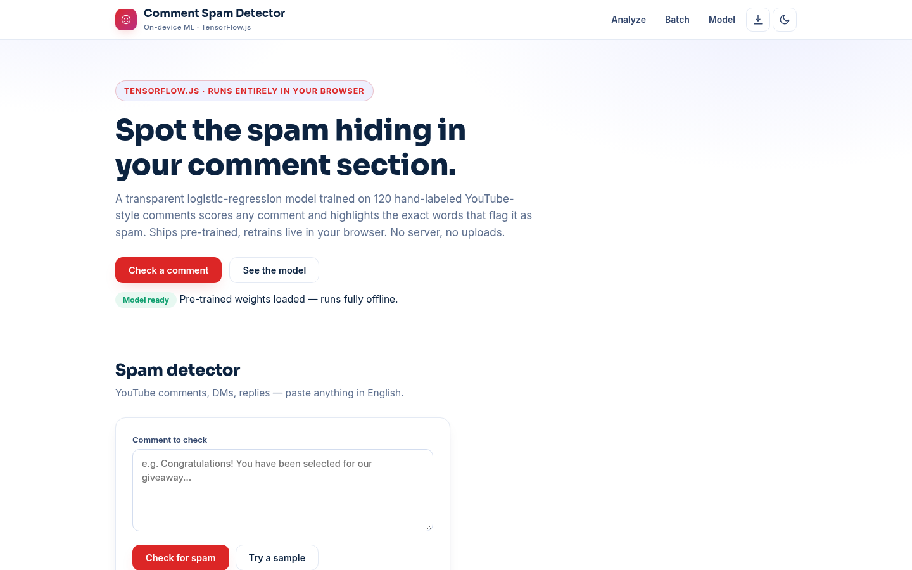

# Comment Spam Detector — Catch YouTube Comment Spam in Your Browser

**Live:** https://akash991833.github.io/comment-spam-detector/

A spam and scam detector for YouTube-style comments that shows its work: a logistic-regression model trained on 120 hand-labeled comments scores any comment and highlights the exact words that flag it as spam. Ships pre-trained for instant verdicts; retrain live in your browser. No server, no uploads, no sign-up.



## Features

- **Instant verdicts** — Spam / Looks genuine / Unclear, with a calibrated spam score
- **Word-level explanations** — occlusion highlights show which words push toward spam (red) or genuine (green), with per-word impact chips
- **Batch screening** — paste a whole comment section, get a spam/genuine/unclear summary and a full table, exportable as CSV
- **Catches the classics** — sub4sub, giveaway scams, crypto and trading scams, "DM me on WhatsApp", link bait, follower sellers, self-promo
- **Live retraining** — retrain the model in your browser any time; nothing leaves your device
- **Honest metrics** — real 5-fold cross-validation with a confusion matrix (out-of-fold predictions)
- **PWA** — installable, works fully offline after first visit
- **Dark & light themes**, responsive on mobile and desktop

## How it works

1. **Tokenize + stem + negation merge** — "did not work" becomes `not_work`
2. **Bag-of-words** — each comment becomes a binary feature vector over a 117-word vocabulary
3. **Logistic regression + L2** — one learned weight per word, trained with TensorFlow.js
4. **Occlusion explanations** — each word is removed and the score change measured

## Honest metrics (5-fold cross-validation, 120 comments)

| Metric | Score |
|---|---|
| Accuracy | 79.8% |
| Precision | 82.1% |
| Recall | 76.7% |
| F1 | 0.79 |

## Honest limits

Trained on 120 hand-written YouTube-style comments. It catches the classics — sub4sub, giveaway and crypto scams, link bait, self-promo — but brand-new spam wording and clever one-off scams will slip through (recall is 77%, so roughly 1 in 4 spam comments in this style is missed). It cannot see context (which video the comment is on) and works in English only. This is a learning project, not a moderation tool — always review before acting on its verdicts.

## Tech

Vanilla HTML/CSS/JS + TensorFlow.js (CDN). No build step, no backend, no tracking.

## Run locally

```bash
python3 -m http.server 8000
# open http://localhost:8000
```

Built by [Akash Vishwakarma](https://github.com/AKASH991833). Free to use — no sign-up, no card.
